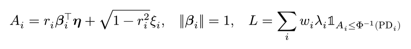
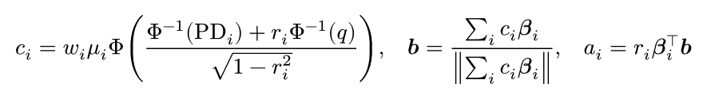
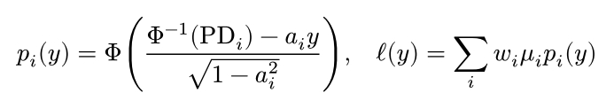
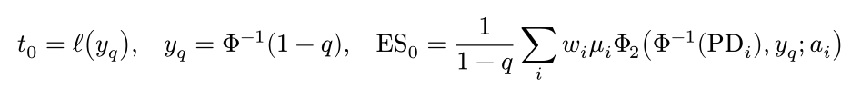
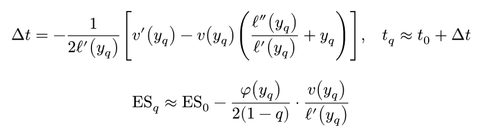
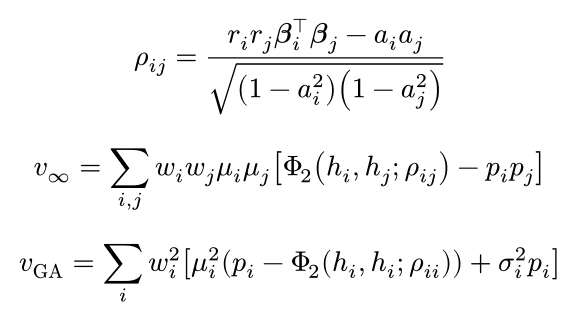
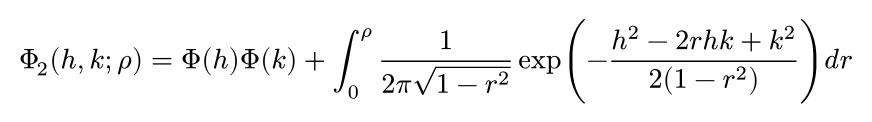

# cpm-approx

Analytical **Value at Risk** and **Expected Shortfall** of a credit portfolio in the multi-factor Merton model — no
simulation, deterministic, fast for portfolios with thousands of facilities. It implements the *multi-factor adjustment*
of M. Pykhtin, "Multi-factor adjustment", *Risk*, March 2004, in Rust with Python bindings. It is not affiliated with the
author of the paper or its publisher.

All figures are **loss rates** relative to total exposure; the loss quantile **includes the expected loss**.

## Install

Python 3.12 or newer, no dependencies (NumPy arrays are accepted as input).

```bash
pip install cpm-approx            # once released on PyPI
pip install --index-url https://test.pypi.org/simple/ cpm-approx    # current test release
```

## Usage

The example portfolio is the one of the paper (Table C: 11 factors, ten buckets, 750 facilities):

```python
from cpm_approx import paper_portfolio, portfolio_risk

r = portfolio_risk(**paper_portfolio(rho=0.5), confidence=0.999)
print(f"VaR {r.var:.2%}  ES {r.es:.2%}  one-factor limit {r.var_limit:.2%}")    # VaR 2.33%  ES 2.76%
```

Your own portfolio, one entry per facility:

```python
r = portfolio_risk(
    pd, lgd, exposure, asset_correlation, 0.999,
    factor_weights=weights,            # sector weights per facility ...
    factor_correlation=corr,           # ... and the correlation matrix of the factors
    lgd_std=lgd_std,                   # optional: standard deviation of the LGD
)
```

- `asset_correlation` is the squared loading R² on the systematic factors.
- Instead of weights and correlation matrix you can pass `loadings` (rows of unit norm on independent factors).
  Without any factor input a single factor is used.
- The result `RiskResult` has `expected_loss`, `var`, `es` and, for comparison, `var_limit` and `es_limit` of the
  comparable one-factor portfolio before the multi-factor and granularity corrections.
- `analyze(dict)` takes and returns JSON-like dictionaries. Invalid input raises `ValueError`.
  The GIL is released during the computation.

The cost grows quadratically with the number of facilities (3000 facilities ≈ 1 s on two cores). The method is a
second-order expansion; for very concentrated portfolios with few facilities, check against a simulation.

## Theory

Portfolio of `M` facilities with exposure weights `w_i`, default probabilities `PD_i`, random LGD `λ_i` with mean `μ_i` and standard deviation `σ_i` (independent of everything else). The asset value depends on `K` independent standard normal systematic factors `η` and an idiosyncratic factor `ξ_i`; a facility defaults when its asset value falls below the threshold. `r_i²` is the asset correlation (`asset_correlation`), `β_i` the unit-norm loading on the factors.

<!-- typst:model
$ A_i = r_i bold(beta)_i^top bold(eta) + sqrt(1 - r_i^2) xi_i, quad norm(bold(beta)_i) = 1, quad L = sum_i w_i lambda_i bb(1)_(A_i <= Phi^(-1)("PD"_i)) $
-->


**Step 1 — comparable one-factor portfolio.** The factors are collapsed to the one direction `b` that matters most in the tail; `a_i` is the effective loading of facility `i` on it.

<!-- typst:direction
$ c_i = w_i mu_i Phi((Phi^(-1)("PD"_i) + r_i Phi^(-1)(q)) / sqrt(1 - r_i^2)), quad bold(b) = (sum_i c_i bold(beta)_i) / norm(sum_i c_i bold(beta)_i), quad a_i = r_i bold(beta)_i^top bold(b) $
-->


Given the single factor `Y = b·η` the conditional default probability and expected loss are

<!-- typst:conditional
$ p_i (y) = Phi((Phi^(-1)("PD"_i) - a_i y) / sqrt(1 - a_i^2)), quad ell(y) = sum_i w_i mu_i p_i (y) $
-->


and for infinitely many small facilities VaR and expected shortfall follow directly (`Φ₂` is the bivariate normal CDF). These are `var_limit` and `es_limit`.

<!-- typst:limit
$ t_0 = ell(y_q), quad y_q = Phi^(-1)(1 - q), quad "ES"_0 = 1 / (1 - q) sum_i w_i mu_i Phi_2 (Phi^(-1)("PD"_i), y_q; a_i) $
-->


**Step 2 — second-order correction.** The real loss is `ℓ(Y)` plus a residual with conditional variance `v(y)`. A Taylor expansion of the quantile in `v` gives

<!-- typst:correction
$ Delta t = - 1 / (2 ell'(y_q)) [ v'(y_q) - v(y_q) ( (ell''(y_q)) / (ell'(y_q)) + y_q ) ], quad t_q approx t_0 + Delta t $
$ "ES"_q approx "ES"_0 - phi(y_q) / (2 (1 - q)) dot v(y_q) / (ell'(y_q)) $
-->


The variance has two parts, the **multi-factor adjustment** (the factors beyond `Y` still move the loss) and the **granularity adjustment** (finite number of facilities, LGD risk), with `h_i = Φ⁻¹(p_i(y))`:

<!-- typst:variance
$ rho_(i j) = (r_i r_j bold(beta)_i^top bold(beta)_j - a_i a_j) / sqrt((1 - a_i^2)(1 - a_j^2)) $
$ v_infinity = sum_(i,j) w_i w_j mu_i mu_j [Phi_2 (h_i, h_j; rho_(i j)) - p_i p_j] $
$ v_"GA" = sum_i w_i^2 [mu_i^2 (p_i - Phi_2 (h_i, h_i; rho_(i i))) + sigma_i^2 p_i] $
-->


`var_rate` is `t_0 + Δt` with `v = v_∞ + v_GA`. The bivariate normal CDF is evaluated with Plackett's identity by Gauss–Legendre quadrature (5 to 24 nodes chosen by `|ρ|`, error below 2·10⁻¹⁵; 40 nodes with the substitution `r = sin t` for `|ρ| ≥ 0.9`):

<!-- typst:plackett
$ Phi_2 (h, k; rho) = Phi(h) Phi(k) + integral_0^rho 1 / (2 pi sqrt(1 - r^2)) exp(-(h^2 - 2 r h k + k^2) / (2 (1 - r^2))) d r $
-->



## Development

```bash
uv sync && uv run pytest      # builds the Rust extension (Rust toolchain required)
cargo test --release          # Rust tests: Table C of the paper, parity with a Python reference implementation
```

The Rust library (`cpm_approx`) and a JSON command line tool (`cpm-approx`) are built from the same sources.

The formulas above are PNG images rendered with [typst](https://typst.app); their typst source is kept in HTML
comments in this README (invisible on GitHub). Edit the comment and run `python tools/formulas.py` to regenerate
`docs/img/*.png`.

## Reference

M. Pykhtin, *Multi-factor adjustment*, Risk 17(3), 2004, 85–90.

## License

MIT
